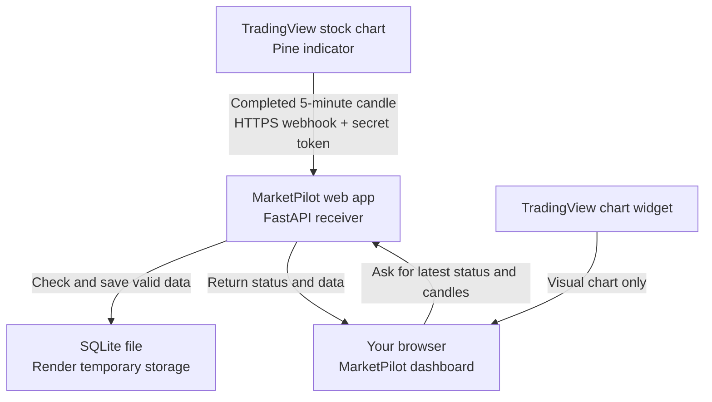

# MarketPilot Architecture Design (ELI10)

**What this document explains:** how MarketPilot gets a TradingView candle, checks it, and shows the result on the website.

## The short version

TradingView runs the MarketPilot indicator on a stock chart. When a five-minute candle closes during regular market hours, the indicator sends that candle's data to the website. The website checks that the data is valid, saves it temporarily, and shows it on the dashboard.

The site does not place orders. A `REVIEW_CALL` or `REVIEW_PUT` is a stock-chart setup to review, not an instruction to buy an option.

## Picture of the system

## The parts, in plain language

| Part | What it does |
|---|---|
| **Pine indicator** (`MarketPilot_TV_Signals.pine`) | Runs inside a real TradingView stock chart. It reads the chart's candles and calculates the daily 9 EMA and 50 SMA, relative strength versus SPY, premarket and prior-day levels, volume, stop, target, and reward-to-risk. |
| **TradingView alert** | Sends a JSON message when each regular-session five-minute candle closes. A setup can be `REVIEW_CALL`, `REVIEW_PUT`, or `WAIT`. Setups are only considered from 9:35 to 11:00 a.m. Eastern; outside that window the indicator sends `WAIT`. |
| **Webhook receiver** (`app.py`) | Receives the message at `/api/tradingview/<secret>`. It checks the secret token and validates the ticker, candle time, price values, and signal before saving anything. |
| **SQLite storage** | Temporarily holds the most recently received candles so the dashboard can display them. The current Render setup stores this file under `/tmp`, which can be cleared when the free service restarts or redeploys. |
| **Website** (`static/index.html`) | Shows the dashboard, connection status, signal, candle chart, risk calculator, and paper journal. It checks for updates about every 30 seconds while the page is open. |
| **TradingView embed** | Shows a visual chart in the webpage. It does not send chart values to MarketPilot; the Pine alert is the data path. The embed may show delayed quotes. |
| **Historical reference file** (`static/verified_history.json`) | Shows a genuine TradingView historical snapshot dated October 9, 2026. It is labeled historical and cannot count as a current signal. |
| **Options risk calculator** | Uses actual option quotes that the user enters manually. TradingView's options chain is not automatically sent to this website. The calculator estimates planned risk and applies the $50 planned-loss rule. |

## How one candle reaches the page

1. You open a stock's five-minute TradingView chart and add the Pine indicator.
2. You create an alert for **MarketPilot → Any alert() function call** and enable its webhook URL.
3. When a regular-session five-minute candle closes, TradingView sends the indicator's JSON message to the Render website.
4. The website checks the private token and the message's fields. It rejects a message with the wrong token or invalid data.
5. The website saves valid candles in SQLite and returns them when the browser asks for that ticker.
6. The dashboard shows the latest candle and verdict. The website forces a `WAIT` if there is no recent candle, the market is closed, or the alert is stale.

The alert is event-driven: creating it does not itself send a candle. The Pine script must reach a completed candle before TradingView sends the first message. Each ticker needs its own chart alert.

## What the connection button checks

**Connect TradingView → Recheck connection** asks the website whether its webhook backend has a token configured and how many ticker symbols have sent data. It does not send a sample alert or force TradingView to send a candle.

`Configured` means the website has a webhook token. `0` tickers means no accepted alert has arrived yet. After an alert arrives, the ticker count should increase. The Dashboard's **Refresh signals** button then reloads the selected ticker's latest snapshot.

## Main website routes

| Route | What it is for |
|---|---|
| `/` | The website dashboard. |
| `/health` | A basic check that the web app is running. |
| `/api/status` | Whether the webhook token is configured and how many tickers have been received. |
| `/api/snapshot/{ticker}` | Recent Pine candles and the current fresh-or-stale verdict for one ticker. |
| `/api/tickers` | Tickers that have sent alerts. |
| `/api/verified-history/{ticker}` | Historical reference data, always marked historical with a `WAIT` decision. |
| `POST /api/tradingview/{secret}` | Private endpoint TradingView calls to submit a candle alert. |

## Hosting and important limits

- Render runs the Python web app and gives it a public HTTPS address.
- `TV_WEBHOOK_TOKEN` is a secret shared between TradingView's alert URL and the receiver. Keep it private. If it is exposed, replace it in Render and update TradingView's alert URL.
- The current Render service uses the free plan. It can sleep when idle, so a webhook can be delayed or missed while the service wakes up.
- The SQLite file is on temporary storage. Received candles and the paper journal are not a permanent record; the journal itself is saved in the user's browser.
- TradingView stops waiting for a webhook after about three seconds. The receiver is designed to validate and save quickly, but the free service waking from sleep can still cause delivery trouble.
- No broker login, brokerage API, or order-placement feature is connected.

## Where the code lives

- `MarketPilot_TV_Signals.pine` — TradingView indicator and alert message.
- `app.py` — web pages' server, webhook validation, and API routes.
- `static/index.html` — browser interface and client-side risk calculator.
- `static/verified_history.json` — dated historical snapshots.
- `render.yaml` — Render service configuration.
- `tests/` — automated checks for webhook validation and historical-data labeling.

**Last checked:** October 9, 2026. The service was live and its backend token was configured. At the time of the check, no ticker alert had reached the site yet.
